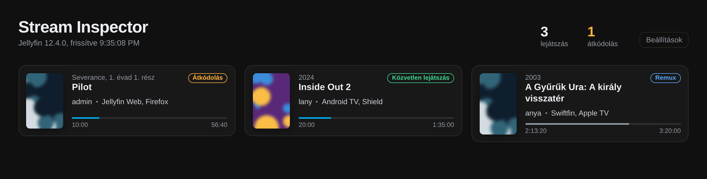
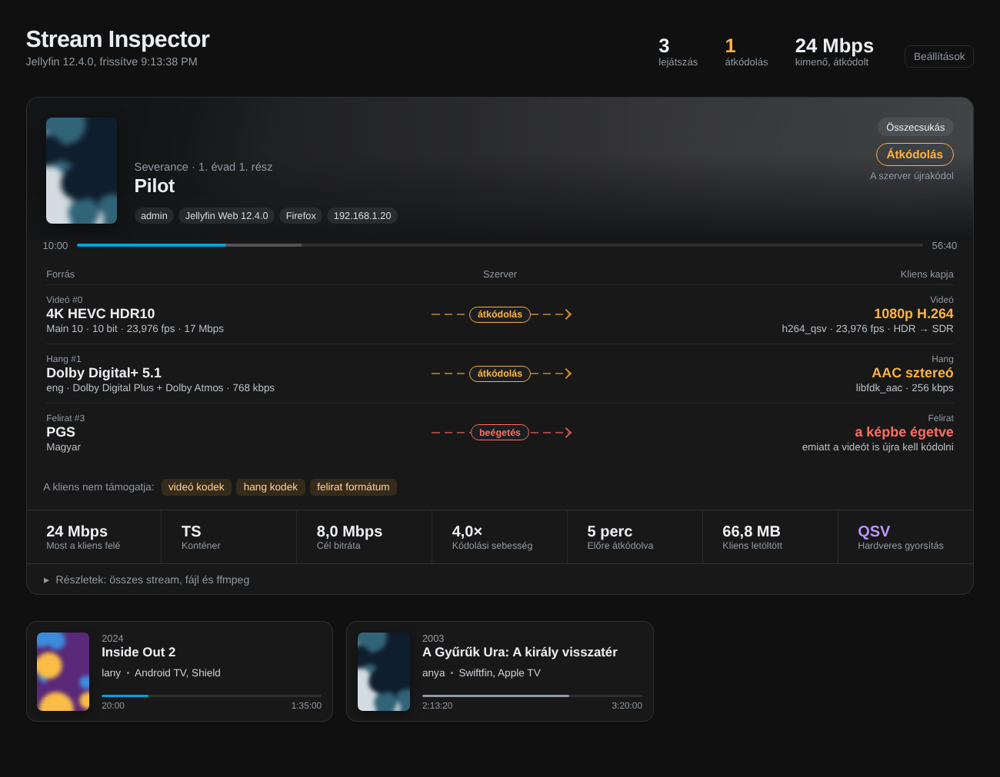

<p align="center"></p>

<h1 align="center">StreamJelly for Jellyfin</h1>

**[English](#english) · [Magyar](#magyar)**



---

## English

StreamJelly is a Jellyfin server plugin that shows, for every active playback, **what the server actually sends to the client**: which source streams are used, whether each one is played directly, copied (remuxed), transcoded or burned in, and the parameters of the running ffmpeg process.

The page lives in the Jellyfin dashboard (left menu → *StreamJelly*), is visible to administrators only, and refreshes itself every few seconds. The user interface is in Hungarian.

### Features

- **Card per playback** – cover, title, user, client, playback mode and progress. Click a card to expand it.
- **Source → Server → Client lanes** – one lane each for video, audio and subtitle, showing the source format, the server's decision and what the client receives (e.g. `4K HEVC HDR10 → 1080p H.264`).
- **Live numbers** – current bandwidth to the client, target bitrate, encoding speed (e.g. `4.0×`), how far ahead the transcode is, data downloaded, hardware acceleration. Values that indicate trouble (encoding speed near 1×, small buffer) turn red.
- **Transcode reasons** – what the client does not support (video codec, subtitle format, bitrate limit…).
- **Client report** – the audio and subtitle track the client last reported, and when.
- **Details** – source file info, every stream of the file (HDR / Dolby Vision type, bit depth, pixel format, colour space, channel layout…), ffmpeg encoder settings and the full ffmpeg command line with a copy button.
- **Totals** – number of playbacks, transcodes and the total outgoing transcoded bandwidth.



### Playback states

| Mode | Meaning |
|---|---|
| **Direct play** (green) | The client receives the original file untouched. |
| **Remux** (blue) | Streams are repackaged into a new container, nothing is re-encoded. |
| **Transcode** (orange) | At least one stream is re-encoded by the server. |

| Per-stream decision | Meaning |
|---|---|
| **original** | Direct play, the stream is sent as it is in the file. |
| **copy** | Same codec, only the container changes (ffmpeg `copy`). |
| **transcode** | The stream is re-encoded (e.g. HEVC → H.264, E-AC-3 → AAC). |
| **burn-in** | The subtitle is drawn into the picture; this forces a video transcode. |
| **separate** | The subtitle is delivered as its own stream or file and rendered by the client. |

### Requirements

- Jellyfin **12.4** (built against `Jellyfin.Controller` 12.4.0, .NET 10). For another 12.x version change `JellyfinVersion` in the `.csproj` and `targetAbi` in `meta.json`.
- To build: Docker, **or** the .NET 10 SDK. The output DLL is platform independent – building on an Apple Silicon Mac for an x86 NAS is fine.

### Build

With Docker (no SDK needed):

```sh
sh build.sh
```

With the .NET SDK:

```sh
dotnet publish -c Release -o bin/publish
```

`build.sh` puts the result into `dist/StreamJelly_<version>/` (`Jellyfin.Plugin.StreamJelly.dll`, `meta.json`, `thumb.png`). When building by hand, copy only `Jellyfin.Plugin.StreamJelly.dll`, `meta.json` and `assets/thumb.png` – never the other Jellyfin / Microsoft DLLs from `bin/publish`.

### Install

1. Copy the `StreamJelly_<version>` folder into the Jellyfin plugins directory:
   - official `jellyfin/jellyfin` image: `<config>/plugins/`
   - `linuxserver/jellyfin` image: `<config>/data/plugins/`
2. Remove the folder of the previous version, if any.
3. Restart the Jellyfin container.
4. Dashboard → Plugins: *StreamJelly* should be *Active*. The page appears in the left menu.

### Settings

Under *Beállítások* (Settings) on the page: auto refresh and its interval, whether file system paths and the ffmpeg command are shown.

### API

```
GET /StreamJelly/Sessions
```

Administrator only. Returns JSON (camelCase) with every session that is playing something: client info, the reported audio / subtitle index, source media streams, output parameters, per-stream decisions and the running transcoding jobs.

### How it works and limitations

- Session data comes from Jellyfin's `ISessionManager`, source streams from `IMediaSourceManager`, output parameters from the session's `TranscodingInfo`.
- **Active audio / subtitle track** – the server only knows what the client reports in `/Sessions/Playing/Progress` (`AudioStreamIndex`, `SubtitleStreamIndex`). If a client does not send these, the plugin cannot show the active track. A subtitle that the client downloads or reads from the file itself creates no server-side stream.
- **ffmpeg jobs** – Jellyfin has no public API to list transcoding jobs, so the plugin reads `TranscodeManager`'s private job list via reflection. If a future version changes it, the plugin keeps working without the ffmpeg panel (the header says so).
- **Burn-in, tone mapping** – detected from the ffmpeg filter arguments (heuristic).
- **"An error occurred while getting the plugin details from the repository"** – shown on the plugin's page because StreamJelly is installed by hand and is not in any plugin repository. Harmless.
- **Plugin card image not updated** – Jellyfin reads `thumb.png` from the plugin folder on every request, no restart needed; the browser caches it, so reload with Cmd+Shift+R or use a private window.
- **Client IP shows localhost** – Jellyfin is behind a reverse proxy. Add the proxy address (usually `127.0.0.1, ::1`) to Dashboard → Networking → *Known proxies*, make sure the proxy sends `X-Forwarded-For`, then restart Jellyfin.

### Project layout

```
Plugin.cs                         plugin entry, dashboard page registration
Configuration/PluginConfiguration.cs
Api/StreamJellyController.cs  REST endpoint, session / stream / ffmpeg analysis
Api/Dtos.cs                       response models
Web/streamjelly.html          dashboard page (HTML, CSS, JS – embedded resource)
meta.json                         plugin manifest
assets/                           logo (SVG), icons, plugin card image (thumb.png)
build.sh                          Docker build
```

---

## Magyar

A StreamJelly egy Jellyfin szerver plugin, ami minden aktív lejátszásnál megmutatja, **mit küld ténylegesen a szerver a kliensnek**: mely forrás stream-ek mennek, közvetlenül, másolva (remux), átkódolva vagy beégetve, és milyen paraméterekkel fut az ffmpeg.

Az oldal a Jellyfin Vezérlőpultjában van (bal oldali menü → *StreamJelly*), csak rendszergazda látja, és pár másodpercenként magától frissül.

### Funkciók

- **Kártya lejátszásonként** – borító, cím, felhasználó, kliens, lejátszási mód és haladás. Kattintásra kibontható.
- **Forrás → Szerver → Kliens sávok** – videóra, hangra és feliratra külön: mi a forrás, mit dönt a szerver, és mit kap a kliens (pl. `4K HEVC HDR10 → 1080p H.264`).
- **Élő számok** – aktuális sávszélesség a kliens felé, cél bitráta, kódolási sebesség (pl. `4,0×`), mennyi van előre átkódolva, letöltött adat, hardveres gyorsítás. A problémát jelző értékek (1× körüli sebesség, kevés puffer) pirosak.
- **Átkódolás okai** – mit nem támogat a kliens (videó kodek, felirat formátum, bitráta-limit…).
- **Kliens jelentése** – melyik hang- és feliratsávot jelentette utoljára a kliens, és mikor.
- **Részletek** – forrásfájl adatai, a fájl összes stream-je (HDR / Dolby Vision, bitmélység, pixel formátum, színtér, csatornakiosztás…), ffmpeg encoder beállítások és a teljes ffmpeg parancs, másolás gombbal.
- **Összesítő** – lejátszások és átkódolások száma, összes kimenő átkódolt sávszélesség.

### Állapotok

| Mód | Jelentés |
|---|---|
| **Közvetlen lejátszás** (zöld) | A kliens az eredeti fájlt kapja, változtatás nélkül. |
| **Remux** (kék) | Új konténerbe csomagolás, újrakódolás nélkül. |
| **Átkódolás** (narancs) | Legalább egy sávot a szerver újrakódol. |

| Sávonkénti döntés | Jelentés |
|---|---|
| **eredeti** | Közvetlen lejátszás, a sáv úgy megy, ahogy a fájlban van. |
| **másolás** | Ugyanaz a kodek, csak a konténer változik (ffmpeg `copy`). |
| **átkódolás** | A sávot a szerver újrakódolja (pl. HEVC → H.264, E-AC-3 → AAC). |
| **beégetés** | A felirat a képbe kerül; ez a videó átkódolását is kikényszeríti. |
| **külön** | A felirat külön stream-ként vagy fájlként megy, a kliens rajzolja ki. |

### Követelmények

- Jellyfin **12.4** (`Jellyfin.Controller` 12.4.0, .NET 10). Más 12.x verzióhoz a `.csproj`-ban a `JellyfinVersion`, a `meta.json`-ban a `targetAbi` értékét kell átírni.
- Fordításhoz Docker **vagy** .NET 10 SDK. A DLL platformfüggetlen: Apple Silicon Macen fordítva is fut x86-os NAS-on.

### Fordítás

Dockerrel (SDK nélkül):

```sh
sh build.sh
```

.NET SDK-val:

```sh
dotnet publish -c Release -o bin/publish
```

A `build.sh` az eredményt a `dist/StreamJelly_<verzió>/` mappába teszi (`Jellyfin.Plugin.StreamJelly.dll`, `meta.json`, `thumb.png`). Kézi fordításnál csak a `Jellyfin.Plugin.StreamJelly.dll`, a `meta.json` és az `assets/thumb.png` kell – a `bin/publish`-ben lévő többi Jellyfin / Microsoft DLL-t ne másold át.

### Telepítés

1. Másold a `StreamJelly_<verzió>` mappát a Jellyfin plugins könyvtárába:
   - hivatalos `jellyfin/jellyfin` image: `<config>/plugins/`
   - `linuxserver/jellyfin` image: `<config>/data/plugins/`
2. Ha van, töröld az előző verzió mappáját.
3. Indítsd újra a Jellyfin konténert.
4. Vezérlőpult → Bővítmények: a *StreamJelly* legyen *Active*. Az oldal a bal menüben jelenik meg.

### Beállítások

Az oldalon a *Beállítások* gomb alatt: automatikus frissítés és gyakorisága, fájlútvonalak és az ffmpeg parancs megjelenítése.

### API

```
GET /StreamJelly/Sessions
```

Csak rendszergazdának. JSON-t ad vissza (camelCase) minden lejátszó munkamenetről: kliens adatai, jelentett hang- / feliratsáv, forrás stream-ek, kimeneti paraméterek, sávonkénti döntések és a futó átkódolási folyamatok.

### Működés és korlátok

- A munkamenet adatai a Jellyfin `ISessionManager`-éből, a forrás stream-ek az `IMediaSourceManager`-ből, a kimeneti paraméterek a munkamenet `TranscodingInfo`-jából jönnek.
- **Aktív hang- / feliratsáv** – a szerver csak azt tudja, amit a kliens a `/Sessions/Playing/Progress` hívásban jelent (`AudioStreamIndex`, `SubtitleStreamIndex`). Ha egy kliens ezt nem küldi, a plugin sem tudja megmutatni. A kliens által letöltött vagy a fájlból olvasott felirat a szerver oldalon nem jár külön stream-mel.
- **ffmpeg folyamatok** – a Jellyfin nem ad publikus API-t az átkódolások listázására, ezért a plugin a `TranscodeManager` belső listáját reflexióval olvassa. Ha egy későbbi verzióban ez megváltozik, a plugin tovább működik, csak az ffmpeg rész tűnik el (a fejléc jelzi).
- **Beégetés, tone mapping** – az ffmpeg szűrőiből felismerve (heurisztika).
- **„Egy hiba történt a plugin adatainak lekérdezésekor az adattárból”** – a plugin adatlapján jelenik meg, mert a StreamJelly kézzel van telepítve, és nincs benne egyik plugin-adattárban sem. Ártalmatlan.
- **Nem frissül a plugin képe** – a Jellyfin minden kérésnél a plugin mappájából olvassa a `thumb.png`-t, újraindítás nem kell; a böngésző viszont gyorsítótárazza, ezért Cmd+Shift+R vagy privát ablak.
- **A kliens IP-je localhost** – a Jellyfin fordított proxy mögött van. Vezérlőpult → Hálózat → *Ismert proxyk* mezőbe írd be a proxy címét (általában `127.0.0.1, ::1`), a proxy küldje az `X-Forwarded-For` fejlécet, majd indítsd újra a Jellyfint.

### Felépítés

```
Plugin.cs                         plugin belépési pont, vezérlőpult oldal regisztrálása
Configuration/PluginConfiguration.cs
Api/StreamJellyController.cs  REST végpont, munkamenet / stream / ffmpeg elemzés
Api/Dtos.cs                       válasz modellek
Web/streamjelly.html          vezérlőpult oldal (HTML, CSS, JS – beágyazott erőforrás)
meta.json                         plugin manifest
assets/                           logó (SVG), ikonok, plugin kártya kép (thumb.png)
build.sh                          Docker fordítás
```
